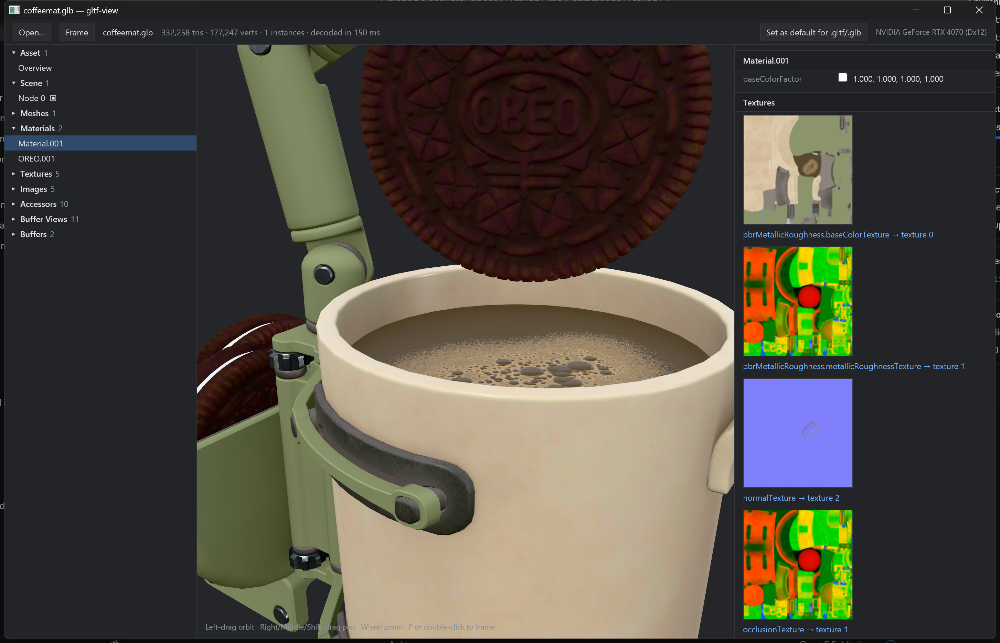

# gltf-view

A small, fast glTF 2.0 / GLB viewer written in Rust with [gpui](https://gpui.rs) and wgpu.


It shows the model and every property in the file: scene graph, meshes, materials
(with color swatches and texture previews), textures, images, samplers, accessors
(with decoded values), buffer views, buffers, animations, skins, cameras and root extensions.
References are clickable: a material's `baseColorTexture` jumps to the texture, then to its image, and so on.

## Supported extensions

| Extension | Status |
|---|---|
| `EXT_meshopt_compression`, `KHR_meshopt_compression` (incl. all filters) | decoded |
| `KHR_draco_mesh_compression` | decoded (pure Rust `draco-core`) |
| `KHR_texture_basisu` (KTX2: ETC1S / UASTC, zstd) | transcoded (Basis Universal) |
| `EXT_texture_webp` | decoded |
| `KHR_mesh_quantization` | supported |
| `KHR_texture_transform` | rendered |
| `KHR_materials_emissive_strength`, `KHR_materials_unlit` | rendered |
| `KHR_materials_pbrSpecularGlossiness` | approximated |
| `EXT_mesh_gpu_instancing` | rendered (instanced draws) |
| everything else | shown in the property panel |

## Animation and skeletons

All animations in the file can be played: node translation/rotation/scale, skinning (on the GPU, any
number of skins and joints), and morph target weights, with STEP, LINEAR and CUBICSPLINE interpolation.
The first animation starts automatically. The bar at the bottom of the viewport has play/pause (**Space**), an
animation picker, a scrubber, playback speed, and **Bones** (**B**), which draws the skeleton on top of the model.
Clicking an animation in the outline also plays it, and its inspector lists every channel with links to the target nodes.

Limits: only the first joint/weight set (`JOINTS_0`/`WEIGHTS_0`) is used, morph targets deform positions and
normals (not tangents), and `KHR_animation_pointer` channels are listed but not played.

## Usage

```
gltf-view [FILE]
gltf-view --register          # Windows: make gltf-view the default for .gltf/.glb
gltf-view --unregister
gltf-view --render IN OUT.png [--anim N] [--time SECONDS] [--bones]   # headless render + timings
```

Open files with **Ctrl+O**, drag-and-drop, or the command line.
Left-drag orbits, right/middle/shift-drag pans, the wheel zooms, **F** or double-click frames the model.

### Double-click to open (Windows)

Click **Set as default for .gltf/.glb** in the toolbar (or run `gltf-view --register`).
This writes per-user registry keys only (no admin). If you had already picked another app
for these extensions, Windows doesn't let other apps override that choice, so the Default Apps
page for gltf-view opens and you choose it there once.

### Linux

`sh packaging/install-linux.sh` builds, installs to `~/.local`, and sets gltf-view as the default for both MIME types.

## Building

Requires a recent stable Rust, a C/C++ compiler (meshoptimizer and Basis Universal are compiled from source),
and libclang (used by bindgen for Basis Universal).

- **Windows:** Visual Studio Build Tools, LLVM (`winget install LLVM.LLVM`). Release builds of gpui
  compile shaders with `fxc.exe` from the Windows SDK. If it isn't found automatically, set:
  `GPUI_FXC_PATH=C:\Program Files (x86)\Windows Kits\10\bin\10.0.22621.0\x64\fxc.exe`
- **Linux (Debian/Ubuntu):** `sudo apt install build-essential clang libclang-dev libxkbcommon-x11-dev libwayland-dev libvulkan-dev libfontconfig-dev`

```
cargo build --release
```

## Why it's fast

- A dedicated render thread owns the GPU: device creation, model upload and frame readback never block the UI.
  The UI keeps at most one frame request in flight, so input never queues up stale frames.
- Buffers, meshopt views, Draco primitives and images are decoded in parallel (rayon); images and geometry run concurrently,
  and both overlap with GPU startup.
- KTX2/Basis textures are transcoded to BC7 (4× less GPU memory and upload than RGBA8). On a GPU without BC support
  they are decoded to RGBA on the CPU instead (`GLTF_VIEW_NO_BC=1` simulates this).
- After upload, decoded vertices and pixels are freed (typically 85–95% of the model's CPU memory). The raw buffers stay
  so accessor values can still be inspected; a GLB's binary chunk is referenced in place, not copied.
- Meshes become one instanced draw per primitive; frames are rendered only when the camera or window size changes
  (about 1 ms on a desktop GPU), at half resolution while orbiting or zooming large viewports.
- Windows uses D3D12 (faster startup than Vulkan). Set `WGPU_BACKEND` to override.

The file is read into memory rather than memory-mapped on purpose: a mapping would lock the file on Windows,
so re-exporting over it from Blender (or anything else) would fail while it's open in the viewer.
